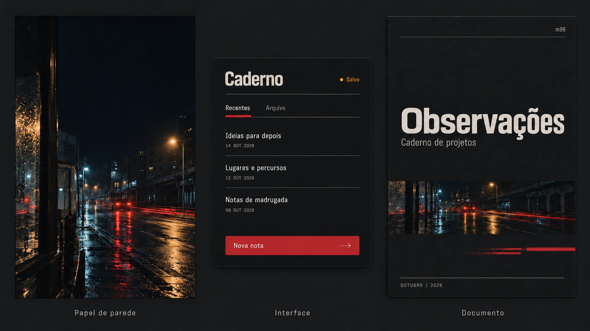

# Identidade visual pessoal — Mau / m96

Registro inicial: 16 de outubro de 2026.
Status: conceito, paleta e direção visual do estudo ajustado aprovados; especificações de produção em desenvolvimento.

## Escopo

Identidade pessoal para dar unidade aos sites, aplicativos, ferramentas e outros projetos de Mau. Independente da identidade do Estúdio Retrovisor. A assinatura é opcional e depende da aplicação: “m96”, “mau.” ou nenhuma das duas. O sistema deve ser reconhecível sem uma marca obrigatória.

## Conceito aprovado

Cidade de madrugada, noite chuvosa, asfalto molhado, lanternas de carros, iluminação pública, letreiros e reflexos.

O eixo emocional é o aconchego dentro da cidade noturna: contemplação, intimidade e sensação de abrigo, com movimento e energia no ambiente urbano. “Refúgio urbano” é uma descrição de trabalho, ainda não um nome ou slogan aprovado.

Cores marcantes e profundas, com pontos luminosos sobre uma base escura. Preservar o clima urbano cotidiano e cinematográfico.

## Paleta aprovada

| Nome | HEX | Papel sugerido |
| --- | --- | --- |
| Noite | #0B1018 | Fundo principal |
| Asfalto | #202A35 | Superfícies e camadas |
| Farol | #E2E6EB | Texto principal e áreas claras |
| Lanterna | #C92C38 | Acento principal e assinatura |
| Petróleo | #258D9E | Acento frio de apoio |
| Âmbar | #CE902F | Acento quente de apoio |

Os valores HEX foram aprovados na amostra “Luzes na madrugada”. Os papéis acima são uma proposta inicial: combinações, proporções e estados de interação ainda precisam ser testados.

### Aprendizados da exploração

- A primeira versão estava suave e dessaturada demais.
- A segunda, com vermelho muito luminoso e ciano elétrico, ficou intensa demais.
- A direção aprovada escurece as cores mantendo sua presença.
- O vermelho deve permanecer profundo e marcante.

## Definições adicionais confirmadas

- Predomina o aconchego de observar uma cidade relativamente vazia, quase liminar, de madrugada.
- Referências concretas: cenas urbanas noturnas, rastros vermelhos de lanternas de carros, asfalto molhado e luzes azuis ou amarelas de postes.
- Imperfeição é bem-vinda. Preferir texturas neutras; evitar uso abundante de gradientes.
- Abrangência: sites, ferramentas, apresentações e documentos, além de usos pessoais como papéis de parede e cores de mostradores do Apple Watch.
- Incluir a materialidade da tecnologia real dos anos 80: CRT, VHS, equipamentos e interfaces físicas. A referência é histórica e analógica, sem assumir retrofuturismo.
- Buscar a maior originalidade possível e evitar soluções visuais genéricas recorrentes em criações de LLMs.

## Referência visual aprovada

Em 16 de outubro de 2026, Mau aprovou o estudo em três formatos e sua versão ajustada como referência principal da identidade.

A imagem é um estudo visual gerado, preservado aqui em JPEG para consulta. Não identifica uma fonte comercial específica, não é uma interface implementada e não substitui os valores HEX da paleta.

### O que a aprovação consolida

- Papel de parede: cidade quase vazia, observada de um lugar protegido, vidro com chuva, asfalto molhado, luzes azuis e âmbar e lanternas vermelhas.
- Composição: amplo vazio escuro, enquadramento assimétrico e áreas de conteúdo concentradas.
- Materialidade: superfícies foscas com textura analógica discreta.
- Interface: divisões funcionais, hierarquia legível, vermelho profundo em ações e seleção; âmbar como pequeno indicador.
- Documento: título com presença, fotografia em faixa recortada, linhas finas e rastros vermelhos interrompidos.
- Refinamento aprovado: menos textura nas áreas de leitura e no botão e leve alívio de peso nos títulos, preservando personalidade e atmosfera.
- Assinatura permanece opcional: “m96”, “mau.” ou nenhuma.

A aprovação é da direção visual. A família Barlow Condensed foi escolhida após este estudo; pesos numéricos, tamanhos, espaçamentos, intensidade técnica da textura, componentes e movimento ainda precisam ser especificados. Os textos “Caderno” e “Observações” são exemplos de aplicação, não nomes obrigatórios ou slogans.

## Direção de exploração derivada do briefing

Propostas a validar nas aplicações, sem tratá-las como decisões finais:

- Usar vazio e enquadramentos deslocados para transmitir observação e quietude.
- Manter vermelho concentrado e marcante; azul e âmbar evocam luz distante.
- Explorar grão fino neutro, pequenas perdas de definição nas imagens e reflexos localizados. Preservar nitidez de texto e controles.
- Usar referências de CRT e VHS com parcimônia. Não tornar scanlines, glitch, neon ou distorção efeitos obrigatórios.
- Estudar divisões funcionais e legendas de equipamentos reais, evitando painéis decorativos sem função.
- Fazer a identidade funcionar sem fotografia, logotipo, monoespaçada ou cartões arredondados como atalhos.
- Usar o estudo aprovado de wallpaper, interface e capa como referência para especificar regras e testar novas aplicações.
- “Refúgio urbano” e quaisquer frases nos estudos são rótulos de exploração, não slogans aprovados.

## Tipografia escolhida

**Barlow Condensed**, escolhida por Mau em 16 de outubro de 2026 após comparação com Archivo Narrow e IBM Plex Sans Condensed.

A escolha foi feita em uma amostra renderizada diretamente dos arquivos reais das fontes, após dúvida sobre o carregamento da primeira comparação. O espécime usou Semibold (600) nos títulos e Regular (400) no texto; esses pesos são referência do teste, ainda não regras finais.

- Fonte oficial: https://github.com/jpt/barlow
- Catálogo: https://fonts.google.com/specimen/Barlow+Condensed
- Licença: SIL Open Font License 1.1, disponível no repositório da fonte.
- Uso independente de assinatura Adobe.
- Aplicação principal proposta: títulos e textos curtos da identidade.
- Ainda definir: pesos, escala, entrelinha, espaçamento, alternativas de sistema e fonte adequada para textos longos.
- Não presumir que a tipografia da imagem gerada original seja exatamente esta fonte.

## Propostas para desenvolver — ainda não aprovadas

### Assinatura e símbolo

A assinatura pode ser “mau.”, “m96” ou estar ausente conforme o projeto. Testar tratamentos tipográficos sem presumir um ponto luminoso como solução. Caso sejam desenvolvidos símbolos ou logotipos, definir versões reduzida e monocromática, favicon, tamanho mínimo e área de proteção.

### Composição

Respiro, alinhamentos claros e assimetria moderada, inspirados em enquadramentos de cidade. Definir grid, margens, espaçamentos, densidade e comportamento em telas pequenas e documentos.

### Superfícies e efeitos

Fundos escuros com camadas distinguíveis. Explorar reflexos difusos, brilho localizado e granulação muito discreta em áreas de atmosfera. Definir limites de transparência, sombras, bordas e raios; manter texto e controles nítidos.

### Fotografia e ilustração

Fotografia urbana noturna com chuva, vidros, ruas, interiores acolhedores e luzes distantes. Definir enquadramento, exposição, tratamento de cor e uso de textura. A identidade também deve funcionar sem fotografias.

### Iconografia e elementos gráficos

Ícones simples e consistentes. Explorar pontos de luz, linhas de reflexo e recortes de janela como vocabulário gráfico. Definir espessura, tamanhos e regras de repetição.

### Movimento

Transições suaves e discretas, com respostas claras à interação. Definir duração, curvas e alternativa com movimento reduzido. Explorar luz e profundidade sem animação decorativa contínua.

### Aplicação em interfaces

Definir botões, links, campos, cartões, navegação, foco, seleção, carregamento e mensagens. Diferenciar a cor de assinatura das cores de erro, aviso e sucesso. Validar contraste por combinação e tamanho de texto; não depender só de cor para comunicar estado. Uma eventual versão clara precisa preservar a mesma assinatura.

### Aplicação em outros formatos

Criar exemplos de capa, apresentação, documento e imagem de compartilhamento, além de uma interface. Definir como a identidade se mantém reconhecível em formatos diferentes.

## Critérios para considerar o sistema completo

- [x] Conceito e atmosfera definidos.
- [x] Paleta base aprovada.
- [ ] Regras de uso e combinações de cores.
- [x] Barlow Condensed escolhida.
- [ ] Hierarquia tipográfica e fonte para textos longos definidas.
- [ ] Assinatura, símbolo e versões definidos.
- [ ] Grid, espaçamentos e formas definidos.
- [x] Direção de imagem e materialidade aprovada no estudo; parâmetros técnicos pendentes.
- [ ] Ícones e elementos gráficos definidos.
- [ ] Movimento e estados de interface definidos.
- [ ] Contraste, legibilidade e acessibilidade verificados.
- [x] Exemplos de wallpaper, interface e documento revisados e aprovados como direção.
- [ ] Tokens reutilizáveis e guia de aplicação publicados.

## Regra de evolução

Preservar a distinção entre decisões aprovadas e propostas. Não transformar as sugestões deste documento em regras definitivas sem nova decisão de Mau. Esta etapa registra a direção; não aplica mudanças automáticas aos projetos existentes.
